<div align="center">

# ClaimVoice

**An AI voice line that takes the first notice of loss for auto and property insurers, at any hour, in English or
French.**

ClaimVoice answers the first call after a loss. It asks for recording consent, verifies the caller and the policy,
checks that everyone is safe, asks the right questions for what happened, texts a photo link and reads the claim
back. Then it routes the claim to fast-track or an adjuster, with reasons. A person is always one sentence away, and
no claim is ever denied by a model.

[Problem statement](docs/PROBLEM_STATEMENT.md) · [Architecture](docs/ARCHITECTURE.md) · [API contract](docs/API_CONTRACT.md) · [Data](docs/DATA.md) · [Compliance map](docs/COMPLIANCE.md) · [Decisions](docs/adr/) · [Fact sheets](docs/model-cards/) · [Evaluation](eval/RESULTS.md) · [Demo script](docs/DEMO_SCRIPT.md) · [Design](frontend/DESIGN.md)

</div>

---

## Why now

It is 2 a.m. in Calgary and a Chinook windstorm is gusting past 100 km/h. Debris blown off a neighbour's deck has just
come through Dana's kitchen skylight. She calls her insurer. At most regional insurers that call reaches an answering
service that takes a name and a number, or a hold queue that has gone from four calls an hour to fourteen. The real
intake happens the next morning, Dana tells the story twice, and the adjuster spends the first part of the claim
re-asking what the first call missed: was anyone hurt, is the house still open to the weather, is water still coming
in.

A voice line can take that call properly, but an insurer can only use one that holds up to the rules it already
works under:

| Rule | What it asks of a claims line | What ClaimVoice does |
|---|---|---|
| **NAIC Model Bulletin on the Use of AI Systems by Insurers** (December 2023, adopted by a growing number of US states) | A written AI program, governance, testing for unfair discrimination, explainable decisions | Two routing checks with plain-word reasons, fairness gates by region, language and age band (never inputs), a fact sheet per check, two sign-offs per version, and no model that can deny a claim |
| **Call-recording consent.** All-party states such as California (Penal Code §632) and Washington (RCW 9.73.030); notice and consent under Canadian privacy law | Ask before recording, and keep nothing without a yes where every party must agree | Consent is the first question. In all-party regions nothing is kept before the yes; a no stops the recording and keeps notes only |
| **PCI DSS** | Card numbers must never end up in a recording or a transcript | The line never asks for payment. If a caller reads a card number anyway, the digits are removed before anything is stored, the recording is silenced for that moment, and the caller is told why |
| **PIPEDA and Québec Law 25** | Consent, retention limits, a person responsible for personal information, French for Québec callers, transparency about automated decisions | French-first calls with an English line for staff, retention per organisation, a privacy officer on file, photos stripped of location, and no decision made by automated processing alone |

Details and the code and tests behind each control: [docs/COMPLIANCE.md](docs/COMPLIANCE.md). ClaimVoice is designed
to support these obligations; it is not certified against any of them.

| Instead of | ClaimVoice does |
|---|---|
| An answering service overnight | A **voice line** that takes the full first notice at any hour, in English or French, with interruptions and corrections |
| A claim file typed from memory | A **live claim file** that fills in as the caller speaks; every value links to the words and the second it was heard |
| "Please hold" during a storm | **Surge handling**: storm questions switch on, the standby team is one press away, urgent callers jump the queue |
| Rules of thumb for who gets the claim | **Routing checks** at hang-up: XGBoost with calibrated scores, plain reasons and fairness gates; a person can change any route |
| Quality checks on a few calls a week | **Every call scored** against a rubric; the ones that need a person open at the moment that went wrong |

## Screenshots

All screens use the synthetic Larkspur Mutual demo with the clock set to Thursday 8 January 2026, 7:42 a.m. Calgary
time. Images live in [`docs/screenshots/`](docs/screenshots/).

| | |
|---|---|
| 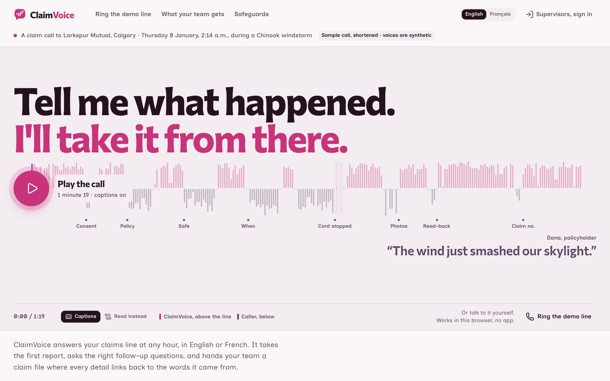 | 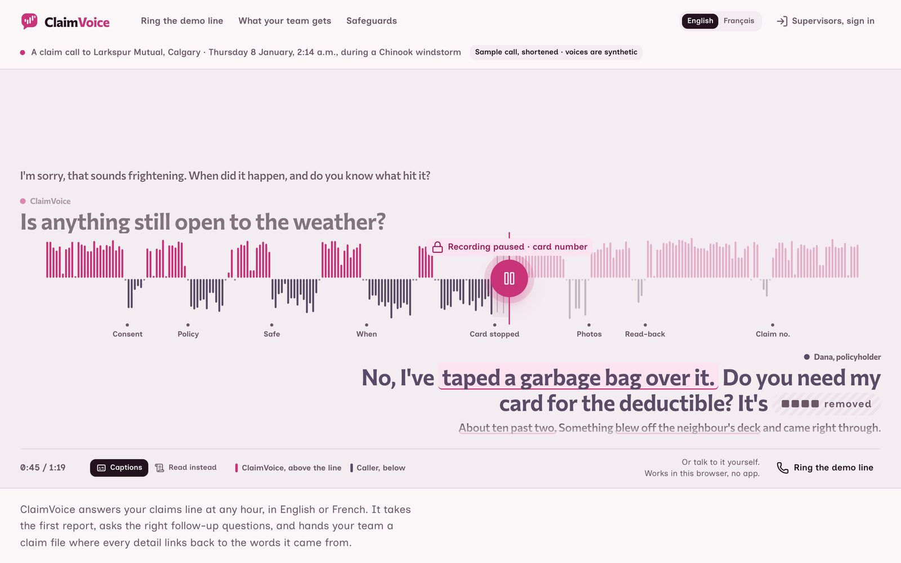 |
| **Landing call.** The recorded claim call is the hero: ClaimVoice's first line above the line, the caller's below. | **Card number hushed.** The caller starts reading a card number; the recording pauses and the digits never appear. |
| 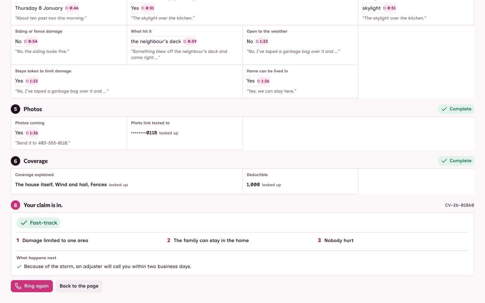 | 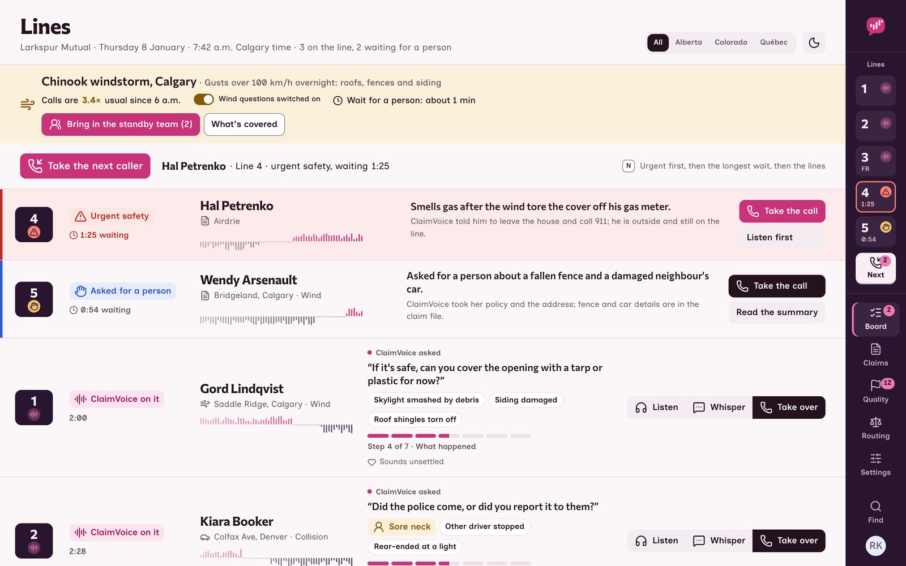 |
| **Ring the demo line.** The claim file fills step by step as you talk, and section 8 brings back the route with three reasons. | **The board.** The Chinook surge as a screener's board: urgent safety first, then the longest wait, then the lines; line keys with lamps on the right. |
| 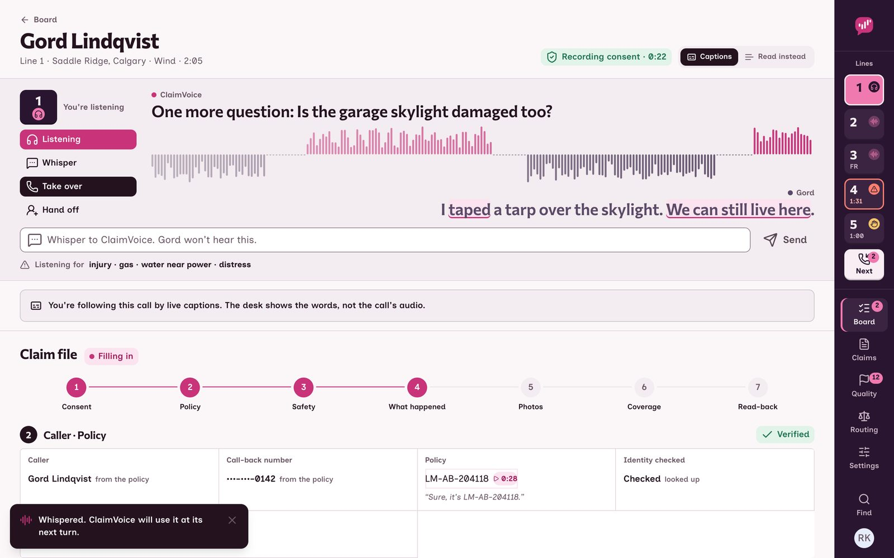 | 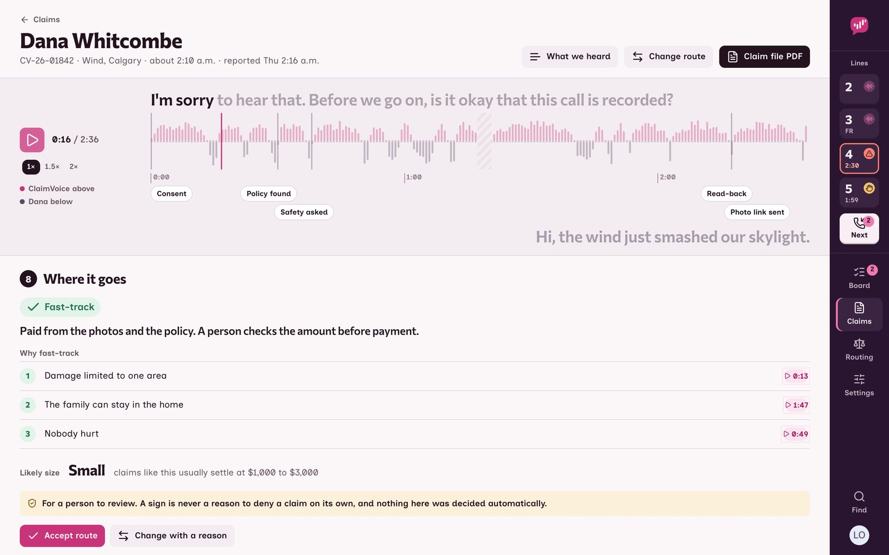 |
| **Whisper.** A live call as a tape over its claim file: a whispered note, and the line asks it at its next turn. | **Claim file.** The recording across the top with the words being said, then where the claim goes, each reason linked to its moment. |
| 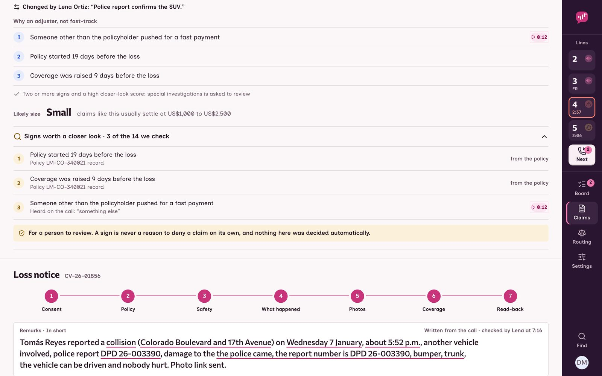 | 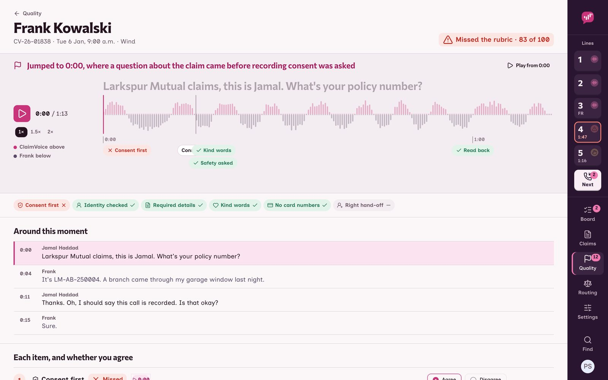 |
| **Closer look.** Three signs, each with where it came from, for a person to review. | **Quality review.** A call opened at the moment consent was missed, with the rubric as a form. |
| 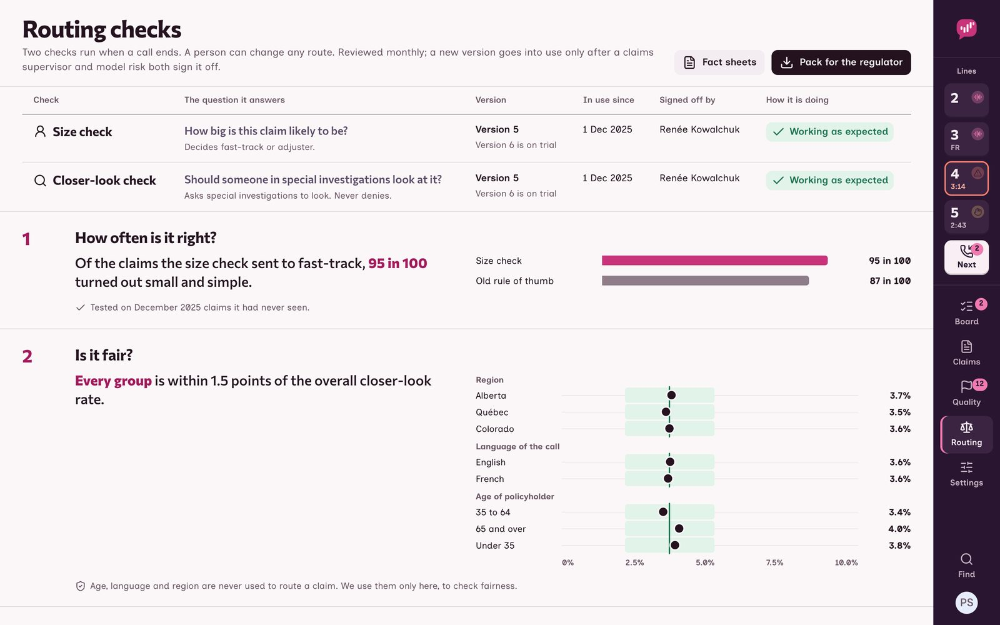 | 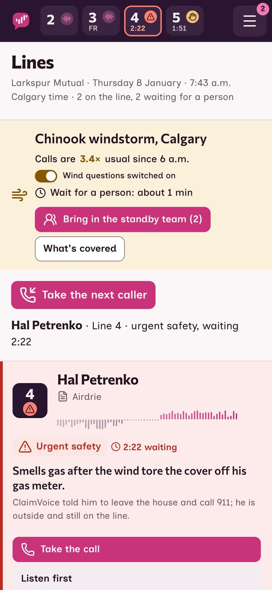 |
| **Routing checks.** Answered as plain questions, with fairness by region, language and age. | **On a phone.** The board at 390 px, with the line keys across the top. |

## Features by role

The seeded organisation has one or more people in each of six roles. Every account uses the password
`larkspur-demo-2026` (sample data only), and the sign-in page offers a one-press demo sign-in as the supervisor or
any other role.

| Role | Person | What they get |
|---|---|---|
| **Claims supervisor** | Renée Kowalchuk (`renee.kowalchuk@larkspur.example`) | The **board**: every live line and every caller waiting for a person as one numbered row, in the order to take them (urgent safety first, then the longest wait), with the step in the seven-step script, what ClaimVoice last asked and what has been heard so far; a **Take the next caller** key; the surge band and the morning's finished claims, all kept live over Server-Sent Events. Line keys with lamps sit in the key bank on every page. **Listen** (follow the call by live captions), **Whisper** (a typed note the line acts on; the caller never hears it), **Take over** (type, and the line says it in its own voice while ClaimVoice keeps taking notes) and hand back. Signs routing-check versions for claims |
| **Intake agent** | Jamal Haddad, Sofía Herrera, Aurélie Fortin (French), plus a standby team of two | Hand-offs that arrive with a two-line summary, so nobody asks the caller twice |
| **Adjuster** | Lena Ortiz | The **claim file**: a two-lane recording (wavesurfer.js), the summary with every phrase linked to its moment, photos from the text link, the route with three reasons and a likely settlement range. Can change a route with a reason |
| **Special investigator** | Dev Malhotra | Closer-look referrals: which of the 14 signs are present, and where in the call or the policy each came from, under the note that a sign is never a reason to deny a claim |
| **Compliance and quality** | Priya Sandhu (model risk, privacy officer), Owen Fairweather (call quality) | The **quality review** queue scored on the rubric; **routing checks** answered as a regulator's four questions, fact sheets, fairness, drift and sign-off; the hash-chained activity log with a one-click integrity check |
| **Administrator** | Nadia Kassem | People and invitations; scripts per loss type (EN/FR); consent rules per state and province; hand-off rules as sentences; languages; retention; the privacy officer |

And for the caller: **Ring the demo line** on the public page calls ClaimVoice from the browser, by voice or by
typing, in English or French.

## Quick start (offline, no accounts)

You need macOS or Linux, Python 3.13, Node 21.7 (see `frontend/.nvmrc`) and `make`. On macOS, XGBoost needs the
OpenMP runtime: `brew install libomp`. No Docker, no API keys.

```bash
make setup      # Python venv from the pinned lock, web app (npm ci), .env from .env.example, migrate, seed
make reset      # (optional) delete the local database, migrate and seed again
make dev        # API + voice runtime on :8040 and the web dev server on :3040 (Ctrl-C stops both)
```

Open http://localhost:3040 and use a demo sign-in button, or sign in as **`renee.kowalchuk@larkspur.example`** /
**`larkspur-demo-2026`** (claims supervisor). `make api` and `make web` run the API and the **production** web build
separately; `make stop` stops every ClaimVoice process. API health: http://localhost:8040/health.

**The demo moment.** The seed is dated by the demo clock: Thursday 8 January 2026, 7:42 a.m. Calgary time, the
morning after an overnight Chinook windstorm (`CLAIMVOICE_DEMO_TODAY`, `CLAIMVOICE_DEMO_TIME`, `CLAIMVOICE_DEMO_TZ`
in `.env`; `off` uses the real date). `make seed` builds Larkspur Mutual from scratch:

- **201 policies** for 174 policyholders in Alberta, Colorado and Québec, and **79 calls** with **63 claims** since
  1 December 2025 (14 of the calls in French). Every route, sign and quality score in the seed was produced by the
  real routing checks and quality scorer at hang-up, not written by hand.
- **Three callers live on the line** (a Chinook-damaged roof and skylight in Calgary, a rear-end collision in
  Denver, a French basement flood in Montréal), driven by scripted callers through the real dialogue engine so you can
  listen, whisper or take over. **Two waiting for a person**, one of them urgent: Hal smells gas in Airdrie after the
  wind tore the cover off his gas meter.
- **An active surge**: calls 3.4× usual since 6 a.m., wind questions switched on, a standby team of two.
- **The SIU-flagged claim CV-26-01856** (Tomás Reyes, Denver): the closer-look check saw 3 of its 14 signs; the
  adjuster changed the route with a reason and the referral stays open. **12 calls** wait in the quality review queue.

**Optional cloud services.** Everything above runs on deterministic offline fakes, and the demo line uses the
browser's own speech recognition and voices. To use cloud services instead, set them in `.env` (every key is listed
in [`.env.example`](.env.example)):

| Service | Settings |
|---|---|
| Language understanding through LiteLLM (any free tier) | `make setup-ai`, then `LLM_FAKE=false`, `LLM_MODEL`, and `GROQ_API_KEY`, `GEMINI_API_KEY` or `OPENROUTER_API_KEY` |
| Speech-to-text | `STT_PROVIDER=groq` (Whisper, `GROQ_API_KEY`) or `deepgram` (`DEEPGRAM_API_KEY`) |
| Text-to-speech | `TTS_PROVIDER=cartesia` (`CARTESIA_API_KEY`, `CARTESIA_VOICE_EN/FR`) or `elevenlabs` (`ELEVENLABS_API_KEY`, `ELEVENLABS_VOICE_EN/FR`) |
| WebRTC beyond one machine | `VOICE_ICE_SERVERS` (STUN/TURN URLs) |

Text messages always go to a fake outbox and the weather lookup uses a bundled alert snapshot.

**Public data.** `make data` downloads freMTPL2 from OpenML (about 8 MB, checksum-pinned) into the git-ignored
`data/` folder. `make train` and `make eval` use it for real claim costs and the public benchmark; the committed model
artefacts score calls without it.

## Architecture

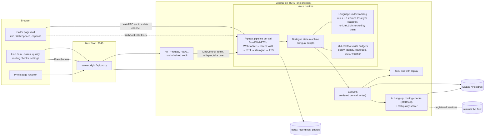

- **One API process hosts the voice runtime** ([ADR 0002](docs/adr/0002-voice-runtime.md)): one Pipecat pipeline
  per call, one copy of the models in memory, and supervisor actions reach a live call directly through `LineControl`.
- **The voice runtime is the only source of call facts and never writes to the database.** Every turn, value, stage
  change, flag, tool call and timing leaves through `CallSink`, which the platform implements: it writes rows in
  order and publishes events to the line desk.
- **Every cloud service sits behind an adapter with a deterministic fake**, so tests, the evaluation and the demo run
  without accounts.
- **Platform:** organisations and tenant isolation on every query, six roles, Argon2id passwords, server-side
  sessions (30 min idle, 12 h absolute), CSRF, rate limits, security headers, RFC 7807 errors, a per-organisation
  hash-chained audit log, `/health` and Prometheus `/metrics`.

### The voice pipeline and the turn budget

A call is a browser peer talking WebRTC directly to the Python process through Pipecat's **SmallWebRTC** transport
(aiortc): no media server and no room service. A `claimvoice` data channel carries JSON both ways. If WebRTC cannot
connect within 8 seconds, the same messages and 20 ms PCM frames go over a WebSocket.

There are three modes. **`browser_speech`** is the default and runs offline: the browser's speech recognition sends
text, the browser speaks the replies with local en-CA and fr-CA voices, and the microphone track still reaches the
server for the recording and for barge-in detection by Silero VAD. In **`voice`** mode the server runs VAD and cloud
speech services. **`typed`** is the accessibility and no-microphone option. Barge-in cancels speech at once in every
mode.

The target is **under 800 ms at p95 from the end of the caller's speech to the start of the reply**. The cloud column
is the allowance per step; the measured column is `make eval` over 443 caller turns in `voice` mode with the offline
fakes:

| Step | Cloud budget | Measured p95 (fakes) |
|---|---:|---:|
| End-of-speech detection (Silero VAD, 0.2 s stop) + speech-to-text | 350 ms | 200.0 ms |
| Language understanding (offline reader with its classifier; cloud: 600 ms hard timeout, then the offline reader) | 180 ms | 0.5 ms |
| Mid-call tools (most turns need none; 200 to 600 ms budget each, with a fallback line) | 100 ms | 0.1 ms |
| Dialogue engine and planning the reply | 20 ms | 0.5 ms |
| Text-to-speech first audio (streaming) | 120 ms | 0.1 ms |
| Transport and jitter buffer | 30 ms | – |
| **Total** | **800 ms** | **200.8 ms** |

Nearly all of the measured time is the VAD's 200 ms stop setting, which is waiting rather than work. Over a real
SmallWebRTC data channel in `browser_speech` mode, `caller.text` to `line.say` takes 1.6 ms at p50 and 2.2 ms at p95
(14 turns). In a real Chrome session the same round trip is about 14 ms at p50; the slowest turn is the wrap-up, where
the claim is created and both routing checks run (640 to 700 ms, still inside the budget). With cloud speech the
total is dominated by speech-to-text and the first synthesised audio; those numbers are budgets, not measurements.

### The dialogue state machine, and why the language model never controls the flow

A first-notice call has obligations in a fixed order: consent before anything is kept, identity before personal
details, safety early, a read-back before the claim number. A free-running language model is good at understanding
words and bad at guaranteeing order, so it is not in charge ([ADR 0003](docs/adr/0003-dialogue-state-machine.md)).

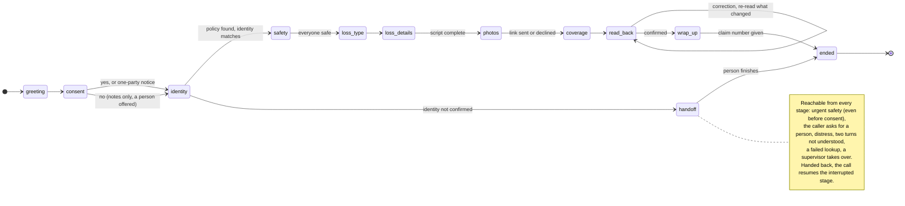

- **Stages, events and transitions are code** (`dialogue/stages.py`): ten scripted stages shown to people as seven
  steps, plus hand-off and ended. Unit tests check that a hand-off is reachable from every stage, that in-stage
  events never move the call, and that a hand-back resumes the interrupted stage.
- **Language understanding works inside a stage.** Given the stage, the values it expects and the utterance (already
  cleared of card numbers), it returns an intent, values with character spans into the transcript, and safety and
  distress signals. It never returns a next stage. The default reader works offline in English and French: rules
  built on shared word lists (vehicles, damaged parts, rooms, water sources, injuries, insurers, answers that lead
  with "not yet" or "nothing broken"), and a learned loss-type classifier for the open wording the rules miss in a
  caller's first sentences ("a pickup clipped my car", "water dripping through my ceiling"). Character and word
  n-gram TF-IDF with logistic regression, trained on a seeded paraphrase corpus, calibrated, 332 KB, 0.2 ms per turn
  at p95 ([fact sheet](docs/model-cards/loss-type-reader.md), [corpus](docs/NLU_CORPUS.md)). A confident reading
  is kept; a less sure one is confirmed ("is this about water damage?") and only a yes keeps it; a no is answered
  with "which kind of loss was it?", never a hand-off. The optional cloud reader goes through LiteLLM with a JSON
  schema and a 600 ms timeout. Its answer is checked before use: values for fields that weren't asked for are
  dropped, each span must point at the words it quotes, and safety words found by the rules are never overruled.
- **Every spoken line comes from a versioned script or a fixed template**, edited in Settings per loss type
  (collision, hail, wind, water, fire, theft) in both languages. A supervisor's whisper adds one question in the
  line's own words.
- **Corrections** supersede earlier values and keep their history and spans; the read-back re-reads only what
  changed.
- **Mid-call tools** run with budgets (policy lookup 300 ms, identity 200 ms, coverage 300 ms, SMS 600 ms, weather
  400 ms). The policy lookup starts as soon as a policy number is heard. A tool that times out returns a fallback and
  the line says "one moment" instead of going silent.

### Routing checks: XGBoost with baselines, calibration, reasons and fairness

At hang-up two checks give the claim its first owner ([ADR 0004](docs/adr/0004-routing-checks.md), fact sheets in
[docs/model-cards/](docs/model-cards/)):

- the **size check** (severity and complexity): the probability that a claim is large or complex, which decides
  fast-track or adjuster, with a typical settlement range;
- the **closer-look check** (fraud indicators): the probability that special investigations would find something
  worth acting on. It refers a claim only when at least two of its 14 signs are present, and a referral is a request
  for review.

**Fixed rules always win** over scores: urgent safety and any possible injury never go to fast-track, water still
coming in or a home open to the weather goes to an adjuster, and a person can change any route with a reason.

**Data and split.** 18,000 synthetic intake records shaped exactly like what the line collects, turned into features
by the same `build_features` the live scorer uses (no training/serving skew). Claim costs are drawn from
**freMTPL2**'s real French motor claim amounts and scaled by loss type and the facts that make a loss bigger. Fraud
labels come from ten documented patterns injected independently of region, language and age (a policy days old,
coverage raised just before the loss, a story that changes, a storm the weather records don't show, and others), with
3 % of labels flipped to mimic investigators disagreeing. The split is by loss month: train before July 2025,
tune and calibrate on July to September, test on October to December 2025 (1,770 test calls).

| Check | Model | AUC | PR-AUC | Brier | ECE |
|---|---|---:|---:|---:|---:|
| Size | Logistic regression (baseline) | 0.849 | 0.720 | 0.1034 | 0.024 |
| Size | Random forest | 0.870 | 0.750 | 0.0965 | 0.020 |
| Size | **XGBoost, Optuna-tuned, isotonic-calibrated (in use)** | **0.887** | **0.766** | **0.0921** | **0.012** |
| Closer look | Logistic regression (baseline) | 0.806 | 0.224 | 0.0338 | 0.011 |
| Closer look | Random forest | 0.856 | 0.222 | 0.0331 | 0.008 |
| Closer look | **XGBoost, Optuna-tuned, isotonic-calibrated (in use)** | **0.858** | **0.389** | **0.0293** | **0.007** |

At the settings in use, the size check sends **91 in 100** large or complex claims to an adjuster, and the
closer-look check refers about **4 in 100** claims, of which 48 in 100 turn out to need a closer look in testing.

- **Reasons in plain words.** Exact TreeSHAP values become the top three reasons as sentences in English and French
  ("Reported 9 days after the loss"), each linked to the moment in the call. The top-five reasons stay the same
  across bootstrap refits (Jaccard 1.00 for size, 0.80 for closer look; gate ≥ 0.70).
- **Fairness gates.** Region, language and age band are never inputs, and neither are postal code, date of birth,
  names or anything about the caller's voice (stress, accent, pitch, speech rate). They are used only to measure
  rate gaps on a 20,000-call audit sample. Largest gaps: **3.5 points** in the fast-track rate (Québec; band ±5) and
  **0.3 points** in the closer-look rate (65 and over; band ±1.5).
- **Drift.** Weekly score PSI against the validation months stays at or below 0.05 in all eight recent weeks, including
  the storm week (Watch at 0.10, Act at 0.25, where fast-track pauses). A deliberately shifted month must raise the
  alarm, and does: PSI 0.45 (size) and 0.69 (closer look).
- **Champion and challenger.** MLflow tracks every run (local SQLite + `mlruns/`); the API reads a registry of
  versions. Version 4 is retired, version 5 is in use, and version 6 is a candidate on trial: it passes every gate,
  scores lower than version 5 on PR-AUC (0.755 vs 0.766 for size, 0.335 vs 0.389 for closer look) and waits for its
  sign-offs. A version
  goes into use only when every gate passes **and two different people sign it**: a claims supervisor and compliance
  for model risk.

> **Honest notes.** The closer-look labels are synthetic, so that check's absolute numbers describe the generator,
> not real-world fraud; what carries over is the method (calibration, reasons, fairness, monitoring, sign-off).
> On freMTPL2 alone, predicting the top tenth of claim cost from policy fields is weak: logistic AUC 0.609, XGBoost
> AUC 0.621 on 26,444 real claims. That is expected, because the size of a loss depends on what happened, which a
> policy table cannot see, and it is why the size check learns from what the caller tells the line. On the
> closer-look check, Platt scaling calibrated slightly better than isotonic (ECE 0.005 vs 0.007); both are well inside
> the 0.05 gate.

### Call quality on every call

Every finished call is scored against an 11-item rubric (`qa/rubric.py`): consent first, the right consent rule,
identity verified, the safety question, required details, kind words, no card numbers, no promises about cover or
payment, a read-back before the claim number, the caller's language honoured and the right hand-off. A failed
critical item fails the call whatever the score. Rules do the scoring; with a cloud reader configured, a language
model also reads two items (kind words and promises), and a promise found by the rules always counts. Calls that fail, that triggered a hand-off rule, or that fall in a random 10 % sample go to the review
queue, where the recording opens at the flagged moment and the reviewer agrees or disagrees per item.

On 338 reviewer verdicts (10 reviewed calls with known problems across every item, and the six headline items on
38 scripted calls) the scorer agrees with the reviewer on every item: Cohen's kappa 1.00. The labelled set is small
and was written alongside the scorer, so this shows the rules match the labels rather than how they would do on a
year of real calls.

## Measured results

### Evaluation gates (`make eval`, offline, 38 of 38 passing)

| Area | Gate | Result |
|---|---|---|
| Dialogue | Scripted callers (EN/FR) ≥ 30; task completion = 1; per-field value accuracy = 1 | 38 callers (9 French); 1.00; 1.00 (126 of 126 values) |
| Dialogue | Safety and hand-off triggers caught; consent asked first; nothing kept before the yes in all-party regions | 1.00 (10 scenarios); 1.00; 1.00 (29 calls) |
| Dialogue | Card numbers caught and removed; card numbers stored anywhere | 1.00 (4 calls); **0** |
| Dialogue | Barge-ins honoured; French calls completed | 1.00; 1.00 |
| Dialogue | First held-out set completed; second held-out set (used for development) completed and values right | 1.00 (8 of 8); 1.00 (8 of 8); 1.00 (22 of 22) |
| Dialogue | Wrong values kept on the main and development sets (≤ 0.02) | **0** of 168 |
| Dialogue | Third held-out set (untouched): completed (≥ 0.5), values right (≥ 0.75), wrong values (≤ 0.05) | 0.67 (8 of 12); 0.81 (50 of 62); 0.016 (1) |
| Dialogue | Offline reader per caller turn, p95 (≤ 5 ms) | 1.0 ms over 814 turns |
| Response time | End of speech to first audio, p95 (≤ 800 ms) | 200.8 ms over 443 turns |
| Response time | Browser speech over WebRTC, `caller.text` to caption, p95 (≤ 800 ms) | 2.2 ms |
| Size check | PR-AUC over the logistic baseline (≥ +0.02); ECE (≤ 0.05); group gap (≤ 0.05); SHAP stability (≥ 0.7); worst weekly PSI (≤ 0.25); large claims to an adjuster (≥ 0.85) | +0.046; 0.012; 0.035; 1.00; 0.050; 0.905 |
| Closer-look check | PR-AUC over the baseline; ECE; group gap (≤ 0.015); SHAP stability; worst weekly PSI; share referred (≤ 0.08) | +0.164; 0.007; 0.003; 0.80; 0.031; 0.035 |
| Drift | Alarm fires on a simulated shift (≥ 0.25) | 0.45 |
| Call quality | Agreement with reviewers (≥ 0.9); Cohen's kappa (≥ 0.7); critical failures marked failed; worst item (≥ 0.8) | 1.00; 1.00; 1.00; 1.00 |

**How to read the dialogue numbers.** The 38 scripted callers are a regression suite written alongside the line, so
100 % there is the expected bar, not a measure of open conversation. Open wording is measured on held-out callers,
before (the rules the line shipped with) and now (the offline reader with its word lists and classifier):

| Caller set | Completed | Values right | Wrong values |
|---|---:|---:|---:|
| Main, 38 callers (written with the line) | 38 → 38 | 126/126 → 126/126 | 0 → 0 |
| Held out 1, 8 callers (used once to widen the rules) | 8 → 8 | 20/20 → 20/20 | 0 → 0 |
| Held out 2, 8 callers (**used for development**) | 1 → 8 | 0/22 → 22/22 | 0 → 0 |
| Held out 3, 12 callers (**untouched**, committed before the reader changed, scored once) | **1 → 8** | **24/62 → 50/62** | **2 → 1** |

The third set is the honest number: wording the line had never seen, in English and French, with multi-fact
openings, hedges, regional words, a correction and an off-script question. The second set's misses ("water dripping
through my ceiling", "the storm ripped shingles off", "a pickup clipped my car") shaped the word lists, so it now only
shows those fixes hold. The word lists alone, without the classifier, take the third set to 2 of 12 and 30 of 62:
reading the opening statement is most of the gain. Of the four third-set calls that still miss, two hand off to a
person after two turns the line couldn't place, and two French calls keep every value but fall out of step with
their scripted answers. Every table: [eval/RESULTS.md](eval/RESULTS.md).

### Tests and performance

Measured on one laptop with everything offline and the demo clock set to Thursday 8 January 2026.

- **Tests:** **760 backend tests** with pytest, all passing (platform, API, RBAC, tenant isolation, SSE, the call
  sink, dialogue, understanding and redaction, the voice runtime over a real SmallWebRTC data channel and the
  WebSocket fallback, routing checks, the quality scorer and the seed story), and **102 web tests** with Vitest across
  8 files (formatting, waveforms, transcripts, streams, the landing call, the API layer, the mock API and key
  components). Ruff (178 files), mypy (127 files), `nuxt typecheck` and ESLint are clean, and `alembic check` finds
  no drift.
- **Browser journeys on the live stack:** 14 journeys and about 120 checked page states with system Chrome, signed in
  through the UI as all six roles: the landing call in English and French with captions, Read instead, reduced motion
  and a phone; the demo line typed in both languages and by Web Speech over WebRTC, and with the microphone refused;
  the line desk live while a demo call runs; listen, whisper (the line asked the whispered question at its next
  turn), take over, a typed line heard by the caller and hand back; an urgent hand-off taken by an intake agent; claim
  playback and a route change (a blank reason refused); the closer-look claim (an intake agent gets no closer-look
  details); a quality review; a routing-check sign-off by a supervisor then compliance (the same person signing twice
  refused); a consent sentence change audited and an all-party region refused when weakened; "Record intact" on the
  activity log; the photo link on a 390 px phone; and an API restart under an open desk, which reconnects by itself.
  **0 console errors, 0 failed requests**, no horizontal overflow at 390 px and no engineering words or raw ids on
  any page.
- **The demo line in a real browser:** over a real SmallWebRTC data channel in Chrome, `caller.text` to `line.say`
  took 14 ms at p50 and 29 to 54 ms at p95 across 35 ordinary turns. The slowest turn is the wrap-up, where the claim
  is created and both routing checks run: 640 to 700 ms, inside the 800 ms budget. The WebRTC channel connected every
  time; the WebSocket fallback was never needed.
- **Live updates:** a caller's turn reaches the line desk as an event in 19 ms at p50 and 34 ms at p95, and is on
  screen in 21 ms at p50 and 147 ms at p95 (12 turns).
- **API speed** (60 paced requests per endpoint, signed in, local SQLite):

| Request | p50 | p95 |
|---|---:|---:|
| Line desk (`/switchboard`) | 29 ms | 32 ms |
| Live lines | 20 ms | 22 ms |
| Claims list / claim detail | 17 ms / 15 ms | 20 ms / 16 ms |
| Claim transcript / routing / call claim file | 10 ms / 9 ms / 10 ms | 13 ms / 11 ms / 13 ms |
| Quality queue | 11 ms | 14 ms |
| Routing checks / size-check fact sheet | 16 ms / 11 ms | 19 ms / 14 ms |
| Activity log | 10 ms | 12 ms |

- **Memory:** the API process with the voice runtime, after several WebRTC calls, has a physical footprint of 248 MB
  (peak 342 MB; 70 to 85 MB resident). The web server's footprint is 45 MB (peak 50 MB).
- **Evaluation and seed:** `make eval` runs all 38 gates in about 22 s. `make reset` (migrate and seed) takes about
  4 s and builds 201 policies, 79 calls, 63 claims, 6 routing-check versions and 143 audit entries.
- **Web build:** a clean production build takes about 9 s; the output is 2.0 MB (495 kB gzipped), client and server
  together.

CI runs Ruff, mypy, a migrations check, the backend tests, the offline seed, the voice toolchain smoke test
(SmallWebRTC loopback and Silero VAD), the freMTPL2 download and the evaluation gates, plus ESLint, the type check,
Vitest and the production build of the web app.

## Security and compliance

| Area | Control |
|---|---|
| Consent | Consent first on every call; rules per state and province in Settings; all-party regions cannot be weakened; a no keeps notes only |
| Card data | Luhn-checked removal of 13 to 19 digit runs, written or spoken, in English and French, before understanding, storage, events or logs; the recording is silenced for that moment; 0 card numbers stored in the evaluation |
| People in the loop | Hand-off reachable from every stage; urgent safety outranks consent and never becomes a call-back; listen, whisper, take over and hand back, all audited; no endpoint approves or denies a claim |
| Models | Never inputs: region, language, age, postal code, date of birth, names, voice features; fairness, calibration, stability and drift gates; two sign-offs per version; fact sheets |
| Personal data | Phone, email and postal code masked in every response; date of birth used only to verify and never returned; photos re-encoded without EXIF location; retention per organisation with an audited purge; a privacy officer on file |
| Platform | Tenant isolation tested on every resource; six roles; Argon2id; short server-side sessions; CSRF; rate limits; security headers; hash-chained audit log with verification |

Every row maps to code and tests in [docs/COMPLIANCE.md](docs/COMPLIANCE.md). ClaimVoice is designed to support the
NAIC Model Bulletin, state recording-consent laws, GLBA, PCI DSS, PIPEDA and Québec Law 25. It is not certified, not
endorsed by any regulator and not legal advice.

## Tech stack

| Area | Technology |
|---|---|
| Voice | **Pipecat** 1.16 with the **SmallWebRTC** transport (aiortc), Silero VAD (ONNX), a WebSocket fallback; offline: the browser's Web Speech API; cloud adapters for Groq Whisper, Deepgram, Cartesia and ElevenLabs |
| Dialogue | An explicit state machine, versioned bilingual scripts (YAML seeded into the database), rule-based EN/FR understanding with spans, optional LiteLLM reader with schema checks |
| API and platform | Python 3.13, **Litestar** 2, msgspec, **SQLAlchemy 2 + Alembic** (SQLite by default, Postgres-ready), Argon2id, structlog, Prometheus client, Server-Sent Events |
| Routing checks | **XGBoost** 3, scikit-learn (logistic regression, random forest, isotonic calibration), **Optuna**, **SHAP** (TreeSHAP), **MLflow** (local tracking), PSI drift, freMTPL2 via fastparquet |
| Web | **Nuxt 3** (Vue 3), TypeScript, **Nuxt UI 3** (Reka UI) themed to the pink palette, Tailwind CSS 4.1, Motion for Vue, VueUse, Web Audio `AnalyserNode` + canvas waveforms, **wavesurfer.js** 7 for recordings, Commissioner and Inclusive Sans self-hosted |
| Quality | pytest, Ruff, mypy, ESLint, `nuxt typecheck`, Vitest, an evaluation harness with 38 gates, GitHub Actions CI |

Pinned versions and why each was chosen: [ADR 0001](docs/adr/0001-toolchain-and-versions.md).

## Data and licences

| Source | Use | Licence |
|---|---|---|
| [freMTPL2](https://www.openml.org/d/41214) (OpenML 41214 and 41215), downloaded by `make data` | Real French motor claim costs for the synthetic records, and the public benchmark | Listed as CC0 on OpenML; originally from the CASdatasets R package (GPL-2+) by Dutang and Charpentier. Not redistributed here |
| Synthetic intake records, Larkspur Mutual seed, scripted callers | Training, evaluation and the demo | Part of this repository (MIT) |
| Weather alert snapshot | Confirming storm losses and the surge | Adapted from public Environment and Climate Change Canada and US National Weather Service alert formats; no alert text copied |
| Landing-page sample call (1.1 MB, EN and FR) | The recorded call on the public page | Generated once with macOS system voices; labelled "Sample call, shortened · voices are synthetic" |

No real person's data is used anywhere. Details: [docs/DATA.md](docs/DATA.md).

## Project layout

```
backend/
  claimvoice/
    api/ platform/ schemas/       Litestar app and routes, auth, sessions, RBAC, audit chain, SSE, errors, metrics
    voice/                        Pipecat pipelines over SmallWebRTC and WebSocket, line manager, recorder, speech adapters
    dialogue/                     stage machine, call engine, bilingual scripts, slot parsing, simulated callers
    nlu/                          offline reader (rules, word lists, loss-type classifier and its corpus), redaction, LiteLLM
    tools/                        mid-call tools: SMS outbox, weather snapshot, toolbox with budgets
    calls/ claims/ policies/      the call sink, hang-up sequence, line desk, claim files, routing, photos, policies
    ml/                           synthetic data, features, training, calibration, reasons, registry, fact sheets
    qa/                           call-quality rubric and scorer
    settings/ seed/               scripts, consent, hand-off, retention, privacy; the Larkspur Mutual seed
  alembic/ tests/
frontend/        Nuxt 3 + Nuxt UI app: landing, demo line, sign-in, the board, live call, claims, quality, routing checks, settings
eval/            evaluation harness (run.py), suites, scripted and held-out callers, labelled calls, RESULTS.md
scripts/         freMTPL2 download, toolchain smoke checks, landing-call audio generator
docs/            problem statement, architecture, API contract, data, compliance map, demo script, ADRs, fact sheets
```

## Make targets

| Target | What it does |
|---|---|
| `make setup` | Python 3.13 venv from the pinned lock, the web app (`npm ci`), `.env` from `.env.example`, migrate and seed |
| `make dev` | API on :8040 and the Nuxt dev server on :3040 together (Ctrl-C stops both) |
| `make api` / `make web` / `make web-dev` | API and voice runtime / production web build served on :3040 / web dev server |
| `make seed` / `make reset` | Seed Larkspur Mutual (idempotent) / delete the local database, then migrate and seed |
| `make migrate` | Apply database migrations |
| `make test` | Backend tests, then web lint, type check, unit tests and production build (`test-backend`, `test-frontend`) |
| `make lint` / `make format` / `make typecheck` | Ruff checks / Ruff fixes / mypy and `nuxt typecheck` |
| `make eval` | Evaluation gates → `eval/RESULTS.md` (dialogue, response time, routing checks, call quality) |
| `make train` | Train both routing checks on CPU, tracked in `mlruns/`, then the loss-type reader |
| `make train-nlu` | Train only the offline reader's loss-type classifier (seeded, about 5 s, same bytes every run) |
| `make data` | Download freMTPL2 into `data/fremtpl2/` |
| `make smoke` | Re-verify the toolchain: Pipecat SmallWebRTC and Silero VAD, and the ML stack on freMTPL2 |
| `make setup-ai` | Optional: install LiteLLM for the cloud language reader |
| `make stop` / `make clean` | Stop every ClaimVoice process / remove caches and build output |
| `make help` | List every target |

## Limitations

- **The demo line is a browser call.** A phone-number (SIP or carrier) transport is future work.
- **Offline speech recognition is the browser's.** Its accuracy is not part of the measured results; the dialogue
  evaluation runs on text from scripted callers.
- **The offline reader handles some open wording, not all.** On twelve held-out callers it had never seen, 8
  complete and 50 of 62 values are right (1 wrong); the rest fall to a re-ask and then a person rather than a guess.
  The set is small, the same team wrote it and the word lists (it was committed first and scored once), and the
  classifier learned from generated sentences that are tidier than speech-to-text. The optional cloud reader remains
  the answer to fully open conversation and is not part of the measured results.
- **The closer-look check is trained on synthetic labels.** See the honest notes above.
- **Supervisors follow live calls by captions, not audio.** Listening to a call's audio and speaking by microphone on
  a take-over are future work; today a supervisor types and the line speaks it.
- **Cloud speech is budgeted, not measured.** The 800 ms budget per turn is met with the offline fakes; cloud numbers
  depend on the provider and region.
- **Text messages and weather are offline.** Photo links go to a fake outbox and storms come from a bundled snapshot.
- **One process.** Several API processes would need a shared SSE bus and sticky routing of each call's WebRTC
  session. CI runs on SQLite only.
- **Deletion requests are counted, not worked.** A request inbox for the privacy officer is future work.

## Licence

MIT for the code. freMTPL2 keeps its own licence and is downloaded, not redistributed. Larkspur Mutual, its callers,
staff and every claim in the demo are fictional.
