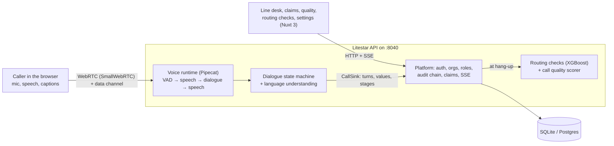

# ClaimVoice

**A voice line that takes the first notice of loss for auto and property claims at any hour, in English or French,
and hands every claim to the right person with reasons.**

ClaimVoice answers the first call after a loss: it asks for recording consent first, verifies the caller and the
policy, asks whether everyone is safe, follows the right script for what happened (collision, hail, wind, water, fire,
theft), texts a photo link, explains coverage basics in plain words, reads the summary back and gives a claim number.
It brings in a person whenever the caller asks, safety is at risk or it is not sure what it heard; supervisors can
listen in, whisper a note the line acts on, or take the call. Every value in the claim file links to the words it
came from. At hang-up two routing checks send the claim to fast-track or an adjuster and ask special investigations
for a closer look when several signs line up, always with reasons, never with a denial.

> Status: in development. The sections marked *(to come)* are filled in as the build lands.

## Why

After a storm, an insurer's intake line goes from four calls an hour to fourteen, overnight calls go to an answering
service that takes a name and a number, and adjusters spend the first part of every claim re-asking what intake
missed. Quality teams hear a handful of calls a week. See [docs/PROBLEM_STATEMENT.md](docs/PROBLEM_STATEMENT.md).

## Screenshots *(to come)*

## Quick start

Requirements: macOS or Linux, Python 3.13, Node 21.7+, `make`; on macOS `brew install libomp` (XGBoost). No Docker,
no accounts, no keys: every cloud service has an offline fake.

```bash
make setup      # Python venv + web app, .env, migrations, demo seed (Larkspur Mutual)
make api        # API and voice runtime on http://localhost:8040  (health: /health)
make web        # web app on http://localhost:3040 (production build)
```

Sign in with the demo button for any role, or as `renee.kowalchuk@larkspur.example` / `larkspur-demo-2026` (sample
data only). The demo clock reads Thursday 8 January 2026, 7:42 a.m. Calgary time (`CLAIMVOICE_DEMO_TODAY`,
`CLAIMVOICE_DEMO_TIME` in `.env`).

Other tasks: `make test`, `make lint`, `make typecheck`, `make eval`, `make train`, `make data` (freMTPL2, ~8 MB),
`make smoke` (voice and ML toolchain checks), `make reset`, `make stop`. `make help` lists everything.

## Architecture



| Part | Stack |
|---|---|
| Voice | Pipecat 1.16 with the SmallWebRTC transport (aiortc), Silero VAD, WebSocket fallback; offline: the browser's speech recognition and synthesis; cloud adapters for Groq Whisper, Deepgram, Cartesia |
| Dialogue | explicit stage machine (10 stages, 7 steps people see), versioned bilingual scripts, mid-call tools with budgets, card-number removal |
| API and platform | Litestar 2, msgspec, SQLAlchemy 2 + Alembic, SQLite (Postgres-ready), Argon2id, hash-chained audit, SSE |
| Routing checks | XGBoost vs logistic and random-forest baselines, Optuna, isotonic calibration, SHAP reasons in plain words, fairness by region/language/age band, PSI drift, MLflow, two sign-offs |
| Web | Nuxt 3, TypeScript, Tailwind 4.1, Motion for Vue, VueUse, Web Audio, wavesurfer.js |

Details: [docs/ARCHITECTURE.md](docs/ARCHITECTURE.md) · contract: [docs/API_CONTRACT.md](docs/API_CONTRACT.md) ·
data: [docs/DATA.md](docs/DATA.md) · decisions: [docs/adr/](docs/adr/).

## Compliance

Designed to support the NAIC Model Bulletin on the Use of AI Systems by Insurers, state call-recording consent
rules (all-party states such as California and Washington), GLBA privacy, PCI DSS (no card numbers by voice),
PIPEDA and Québec Law 25. Not a certification. See [docs/PROBLEM_STATEMENT.md](docs/PROBLEM_STATEMENT.md) and
[ADR 0005](docs/adr/0005-consent-card-numbers-and-people-in-the-loop.md).

## Measured results *(to come)*

`make eval` writes [eval/RESULTS.md](eval/RESULTS.md): dialogue task completion and value accuracy on scripted
callers (EN/FR, interruptions, corrections), safety triggers, consent order, card numbers stored (target 0), response
time per turn (target p95 < 800 ms), routing checks vs baselines, fairness gaps, drift, and quality-scorer agreement.

## Limitations

- The demo line is a browser call; a phone-number transport is future work.
- Offline speech recognition is the browser's; recognition quality is not part of the measured results.
- The closer-look check is trained on synthetic data with documented injected patterns; its numbers describe the
  method, not real-world fraud rates.

## Licence

MIT © Moeiz Shahzad. freMTPL2 is downloaded at setup from OpenML and is not redistributed here.
