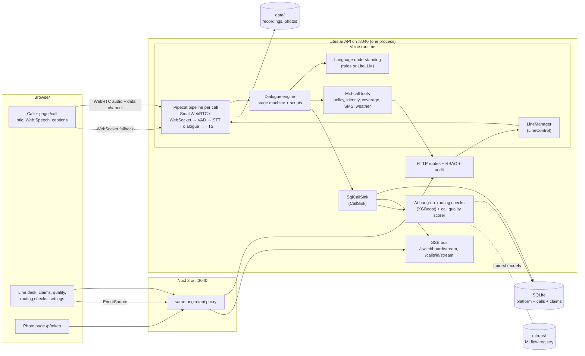

# Architecture

ClaimVoice is two processes on one machine: the **API** (Litestar, Python 3.13, port 8040), which also hosts the
**voice runtime** (Pipecat pipelines, one per live call), and the **web app** (Nuxt 3, port 3040). SQLite holds
everything by default; the schema is Postgres-ready. Every cloud service sits behind an adapter with an offline,
deterministic fake, so the whole product runs without accounts or keys.

## The call path

1. **Ring.** The browser posts `POST /api/v1/calls` (or `/demo/calls` from the landing page). The platform creates
   the call, mints a caller token and asks the voice runtime to prepare a line.
2. **Connect.** The browser sends an SDP offer; Pipecat's `SmallWebRTCConnection` (aiortc) answers it directly, with
   no media server and no third-party room service. Trickle ICE goes over `PATCH`. A `"claimvoice"` data channel
   carries JSON messages in both directions. If WebRTC cannot connect within 8 s, the same messages and PCM audio
   travel over a WebSocket on the API.
3. **Listen.** In the default offline mode (`browser_speech`) the browser's own speech recognition turns the
   caller's words into text and sends `caller.text`; the microphone track still reaches the server for the recording
   and for barge-in detection by Silero VAD. In `voice` mode the server runs VAD and a cloud speech-to-text service.
   In `typed` mode the caller types.
4. **Understand, inside a stage.** The dialogue engine redacts card numbers first, then asks the language
   understanding adapter for an intent, slot values with character spans and safety/distress signals. The fake is
   rule-based (EN/FR); the cloud adapter calls a small model through LiteLLM with a strict JSON schema and a 600 ms
   timeout, falling back to the rules on timeout.
5. **Decide, with the state machine.** The engine applies the slot values, decides the stage event from the script's
   completion rules and calls `next_stage`. Control flow never comes from a language model. Global events (urgent
   safety, a request for a person, low confidence, distress, a failed lookup) move the call to a person from any
   stage.
6. **Act.** Mid-call tools run with budgets (policy lookup 300 ms, identity 200 ms, coverage 300 ms, SMS 600 ms,
   weather 400 ms); the policy lookup starts as soon as a policy number is heard, before the stage asks for the next
   detail. A tool that times out returns a fallback and the line says "one moment" rather than going silent.
7. **Speak.** The next prompt comes from the script (never improvised) and is sent as `line.say`: spoken by the
   browser's `speechSynthesis` (local system voices, en-CA / fr-CA) in `browser_speech` mode, or synthesised by the
   cloud text-to-speech service and streamed on the WebRTC audio track in `voice` mode. Barge-in cancels speech
   immediately on both sides.
8. **Record facts.** Every final turn, slot, stage change, flag, tool call and timing goes to `CallSink`, which the
   platform implements: it writes the rows and publishes SSE events to the line desk and to anyone listening.
9. **Hang up.** The platform purges turns that may not be kept (consent refused), creates the claim, runs the two
   routing checks and the quality scorer, opens a closer-look referral when the signs line up, and publishes
   `line.closed` and `claim.created`.

## Response-time budget (per caller turn, p95 < 800 ms)

Measured from the end of the caller's speech to the first audio (or first caption, in `browser_speech` mode) of the
line's reply.

| Step | Cloud budget (`voice` mode) | Offline fakes, p95 measured by `make eval` | Notes |
|---|---:|---:|---|
| End-of-speech detection (Silero VAD, 0.2 s stop) | 200 ms | 200 ms | Pipecat's VAD analyser; 0.1 ms of CPU per 32 ms chunk |
| Speech-to-text final | 150 ms | < 0.1 ms | Groq Whisper or Deepgram (2 s timeout); browser recognition in the offline mode |
| Language understanding | 180 ms | 0.3 ms | 600 ms hard timeout, then the rules path |
| Tools (most turns need none) | 100 ms | 0.1 ms | budgets 200 to 600 ms each, with a fallback |
| Dialogue engine + `CallSink` writes | 20 ms | 0.3 ms | sink calls must return within 20 ms p95 |
| Text-to-speech first audio | 120 ms | 0.1 ms | streaming TTS (Cartesia or ElevenLabs); offline the browser speaks locally |
| Transport and jitter buffer | 30 ms | not in the total | same machine or same region; 3.4 ms p95 over a real SmallWebRTC data channel |
| **Total** | **800 ms** | **201 ms** | the eval gate is p95 < 800 ms with fakes and VAD |

Measured over 444 caller turns from 38 scripted calls in `voice` mode (the 200 ms is the VAD's stop setting, not
work), and over a real SmallWebRTC data channel in `browser_speech` mode (14 turns), where the round trip from
`caller.text` to `line.say` is 1.5 ms p50 and 3.4 ms p95 on one laptop. With cloud speech the budget is dominated by
speech-to-text and the first synthesised audio; the table's cloud column is the allowance per stage, not a
measurement.

## Ownership inside the API process

- The **voice runtime** owns a live call's state in memory and is the only source of call facts. It never writes to
  the database.
- The **platform** owns the database, audit, SSE and every HTTP endpoint, and implements `CallSink`,
  `PolicyDirectory` and `OrgPlaybook`. It never drives the dialogue; supervisor actions go through `LineControl`.
- The **routing checks** and the **quality scorer** are pure functions over a frozen input (`TriageInput`, the
  transcript and events), called by the platform at hang-up.

The full interface list and sequences are in docs/API_CONTRACT.md Part 3.

## Platform

- **Tenancy:** every tenant-owned row has `org_id`; every query filters by the active organisation, and another
  organisation's ids return 404.
- **Auth:** opaque session cookie (HMAC stored server-side, 30 min idle, 12 h absolute on the real clock), CSRF token
  for unsafe methods, Argon2id passwords, rate limits; caller-leg endpoints use a short-lived bearer token.
- **Roles:** administrator, claims supervisor, intake agent, adjuster, special investigator, compliance and quality
  (`platform/permissions.py`).
- **Audit:** an append-only, hash-chained log per organisation (`platform/audit.py`); `GET /audit/verify` re-checks
  the chain.
- **Errors:** RFC 7807 problem details everywhere, with a request id.
- **Demo clock:** `CLAIMVOICE_DEMO_TODAY` (+ `CLAIMVOICE_DEMO_TIME`) shifts business time for the seed, the API and
  the voice runtime; every response carries `X-ClaimVoice-Now` for the web app. Security timers use the real clock.
- **Observability:** structured logs with request and call ids, `/health`, Prometheus `/metrics` (live calls, turn
  response-time histogram, tool timeouts, SSE subscribers).

## Routing checks (classical ML)

Two XGBoost models, trained on CPU (`make train`) and tracked in MLflow (local SQLite + `mlruns/`):

- **Size check** (severity/complexity): calibrated probability that a claim is large or complex, which decides
  fast-track or adjuster, with a typical settlement range.
- **Closer-look check** (fraud indicators): calibrated probability that a claim deserves review by special
  investigations, opened only when at least two signs are present.

Each is compared with a logistic-regression baseline and a random forest, tuned with Optuna, calibrated with isotonic
regression, explained with SHAP translated into plain reasons, tested for fairness by region, language and age band
(used only for testing, never as inputs), and monitored for drift with PSI. Fixed rules always win (a possible injury
is never fast-tracked). Details: docs/adr/0004 and docs/API_CONTRACT.md Part 6.

## Deployment shape

The demo runs locally: `make setup`, then `make dev` (or `make api` and `make web` for the production web build).
For production the same API process can run behind a TLS proxy with Postgres, a TURN server for callers outside the
local network (`VOICE_ICE_SERVERS`), and the cloud speech and language adapters switched on by environment
variables. Several API processes need a shared SSE bus and sticky routing of a call's WebRTC session to the process
that holds it; that is noted as future work.
